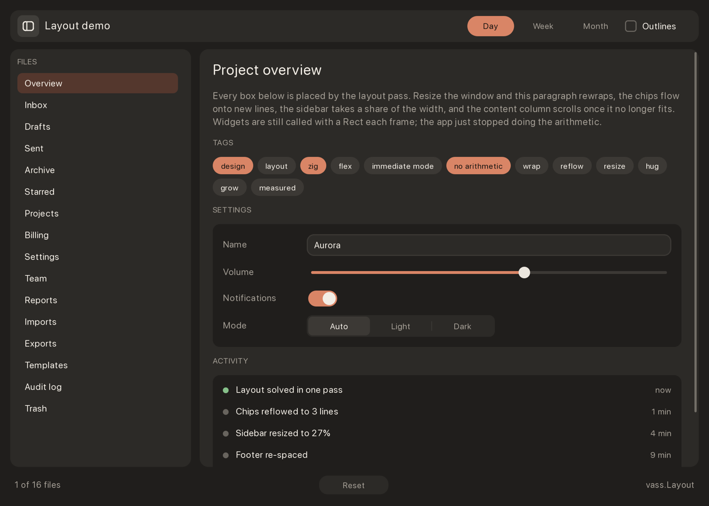
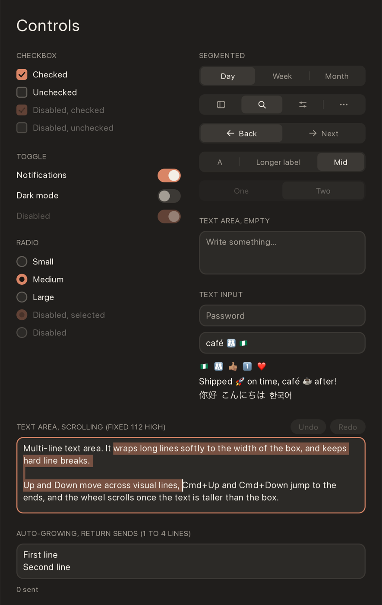

# Vass

A GUI toolkit for Zig: an immediate-mode `Ui` over a display list, drawn by SDL3.

`zig build` compiles all of it from source, with no system libraries. From the Latin *vas*, a vessel.

**Status:** pre-0.1. macOS only. The API will change.

Built app-first: a feature lands when a real program needs it. Two applications run on it today,
a menu-bar utility and a three-pane desktop client.

| 0 | ~30 s | 500+ | 1 |
| :-: | :-: | :-: | :-: |
| system libraries | first build | tests | platform (macOS) |

<p>
  
</p>
<p>
  
</p>

## Hello, window

```zig
const std = @import("std");
const vass = @import("vass");

const Hello = struct {
    clicks: u32 = 0,

    pub fn frame(app: *Hello, ui: *vass.Ui) void {
        var area = ui.bounds.inset(24);
        ui.labelFmt(area.cutTop(28), "Clicks: {d}", .{app.clicks}, .{ .size = 16 });
        if (ui.button(area.cutTop(36), "Click me", .{})) app.clicks += 1;
    }
};

pub fn main(init: std.process.Init) !void {
    var app: Hello = .{};
    try vass.run(Hello, &app, .{
        .gpa = init.gpa,
        .window = .{ .title = "Hello", .width = 320, .height = 160 },
    });
}
```

`vass.run` opens the window and runs the loop. Your struct holds the state and a `frame` function.
The loop calls it once per frame and renders.

Add `setup`, `teardown`, `event` or `update` and the loop finds them by name.

Run it from a clone: `zig build hello`.

## What is in the box

- **One call runs the app.** `vass.run` for one window, `vass.Runner` for many, each with its own
  state type and `frame`. Hooks: `setup`, `teardown`, `event`, `update`, `afterFrame`,
  `closeRequested`, `theme`.
- **Two redraw policies.** `.always` draws at a steady rate. `.on_demand` sleeps in the OS event
  wait until input, a timer or an animation asks for a frame.
- **Scripted runs.** Hidden window, fake clock, injected clicks and keys, BMP snapshots
  (`Config.script`). The screenshots above were made this way.
- **Window plumbing.** Live-resize redraw, mouse cursors (`ui.setCursor`), dropped files, the
  system open-file dialog.
- **macOS extras.** Menu-bar items, overlay windows, a unified title bar, window vibrancy, the Dock icon.
- **Widgets.** `label`, `labelWrapped`, `textSelectable`, `button`, `pill`, `chip`, `tabs`,
  `checkbox`, `toggle`, `radio`, `segmented`, `slider`, `waveform`, `listRow`, `iconButton`, `card`,
  `meter`, `bar`, and scroll areas (`beginScroll`/`endScroll`).
- **Popups.** `menu` (icons, shortcuts, checks, danger and disabled items, separators),
  `contextMenu`, `dropdown`, `tooltip`, and panels with `beginPopup`/`endPopup`, modal dialogs
  included. Nest four deep. Widgets underneath stop receiving input.
- **Text input.** `textField` and `textArea` edit by grapheme cluster and draw input-method
  composition inline. Undo, redo, clipboard, selection by word and line, a right-click menu, a
  password mode. The editor behind them, `vass.TextEdit`, works without the widgets.
- **Text rendering.** SDL_ttf with HarfBuzz shaping, colour emoji through Apple Color Emoji,
  fallback fonts for CJK and symbols on macOS, your own TTFs and weights (`WindowOptions.fonts`),
  bold, italic, monospace, underline and strikethrough (`gfx.TextStyle`), and font metrics
  (`Ui.fontMetrics`) to put runs of different styles on one baseline.
- **Styled paragraphs.** `vass.Paragraph`: lay out runs of styled text once at a width, then draw
  it as often as you like; caret, hit-test and selection queries. Left to right, with simple
  line-breaking rules.
- **Rect cutting.** `cutTop`, `cutLeft`, `inset` for a strip or two.
- **Flex layout.** `vass.Layout`: `.fixed`, `.grow`, `.hug`, `.percent`, wrapping, scrolling,
  absolute positioning. Solved in the frame it is declared.
- **Split panes.** `ui.splitter` with `vass.split.two` and `three`: draggable, collapsible,
  keyboard-controlled.
- **Keyboard focus.** Tab and Shift+Tab order, a focus ring shown only after keyboard use, Space and
  Enter activation, and `ui.focusable` for custom widgets.
- **Images.** PNG, JPEG, BMP and GIF decoding. `ui.image` with fill, contain and cover fits,
  rounded corners, opacity and tint.
- **SVG.** Paths, shapes, transforms and gradients, parsed and rasterised in Zig (`win.loadSvg`),
  at the device pixel size, cached.
- **Audio.** `vass.audio.Audio`: WAV, Ogg Vorbis and MP3 decoding, a 32-voice mixer with looping,
  pause and seek, microphone recording with a level meter, peaks for waveforms, WAV export.

No reference docs yet. Each example in `examples/` covers one area.

## What is not there yet

- No screen-reader support. Widgets register roles and labels for the focus order, but nothing is
  passed to the OS.
- No platform other than macOS.
- No light theme, and no following the system appearance. One dark palette, set through a `Theme`
  struct.
- Input methods are untested with real Japanese, Chinese or Korean input.
- No submenus, scrollbar dragging or horizontal scrolling.
- Emoji newer than the system emoji font draw as boxes.
- No right-to-left or bidirectional text, and line breaking follows simple rules, not the full
  Unicode algorithm.

## Using it in your project

You need Zig 0.17.0 or newer and macOS 13 or later with Xcode or the Command Line Tools. Nothing
else is installed: SDL3, SDL_ttf, FreeType, HarfBuzz, libpng, zlib and the other C code are fetched as
pinned dependencies and compiled from source by the Zig build, with no system libraries. The first
build takes roughly half a minute; later builds reuse the cache.

```sh
zig fetch --save git+https://github.com/vasskit/vass
```

or, from a local checkout, in `build.zig.zon`:

```zig
.dependencies = .{
    .vass = .{ .path = "../vass" },
},
```

In `build.zig`:

```zig
const vass_build = @import("vass"); // Vass's build.zig, for default_target

const target = b.standardTargetOptions(.{ .default_target = vass_build.default_target });
const optimize = b.standardOptimizeOption(.{});
const vass = b.dependency("vass", .{
    .target = target,
    .optimize = optimize,
}).module("vass");
// then: .imports = &.{.{ .name = "vass", .module = vass }} on your module
```

`default_target` is the host with a macOS 13.0 deployment target. Pass `-Dtarget=aarch64-macos.14.0`
(or any version) to override it. To build against Homebrew's SDL3 and SDL_ttf instead of compiling them,
set `.@"system-sdl" = true` in the dependency options (an escape hatch; the default needs no system libraries).

## Examples

```sh
zig build -l                        # lists the steps, one per example
zig build controls                  # runs examples/controls.zig
zig build controls -- --snapshot DIR   # hidden window; writes DIR/controls.bmp and exits
zig build examples                  # builds all of them
zig build test                      # unit tests; also compiles every example
```

There are examples for `hello`, `controls`, `layout`, `split`, `popups`, `windows` (several windows),
`notes`, `images`, `icons`, `audio`, `vibrancy`, `text_styles` and `paragraphs`.

## Repository layout

`src/` is grouped by the package each folder could become; `src/vass.zig` is the public root.

- `src/core/`: geometry and colours, the display list, key codes, image handles, a PNG writer.
- `src/platform/`: the SDL3 backend (windows, input, text, rendering) and the macOS extras.
- `src/text/`: the editing core, undo history, grapheme and emoji segmentation, paragraph layout.
- `src/layout/`: the flex-style layout solver.
- `src/image/`: image decoding, the SVG parser and rasteriser.
- `src/audio/`: sound decoding, the mixer, playback and recording.
- `src/ui/`: the immediate-mode `Ui`: widgets, popups, focus, split panes, icons.
- `src/app/`: the application loop (`vass.run`, `vass.Runner`).
- `build/` (how the C dependencies are compiled), `examples/`, `tools/` (the Unicode table generators).

The layering rule: `core/` imports nothing outside itself; `text/`, `layout/` and `image/` import only
`core/`; only `platform/` talks to SDL; `ui/` sits on `core/`, `text/`, `layout/` and `platform/`; `app/`
sits on `ui/` and `platform/`, and nothing imports `app/`.

## Design

The toolkit is a stack. Widgets in `ui/` are immediate mode: each frame your code calls them in
order, each draws itself into a display list (drawing recorded as plain data, with no platform
types) and returns what the user did with it from the same rectangle, so there is no separate
hit-testing. A backend turns the display list into pixels; today that is SDL3 with SDL_ttf, plus
macOS extras through the Objective-C runtime. State is the caller's: widgets that need memory across
frames take a state struct that you own and keep at a stable address, and there is no hidden
per-widget state. The application loop in `app/` is the glue every program would otherwise write: windows, events, one
frame per window, redraw policy and scripted runs. A retained core and a C ABI may come later;
nothing is promised.

## Third-party code and licences

Everything below is compiled from source into your binary, except the example assets. Licences
were read from the files shipped with each package.

| Component | Version | Licence |
| --- | --- | --- |
| SDL3 (built through the castholm/SDL Zig package) | 3.4.20 | zlib. Some files carry other permissive licences; see the package |
| SDL_ttf | 3.2.2 | zlib |
| FreeType | 2.14.3 | FreeType License or GPL 2, at your choice |
| HarfBuzz | 15.1.0 | "Old MIT" |
| libpng | 1.6.58 | PNG Reference Library License version 2 |
| zlib | 1.3.2 | zlib |
| stb (stb_image, stb_vorbis) | commit 9600522 | public domain or MIT, at your choice |
| dr_libs (dr_mp3) | commit f12e197 | public domain or MIT No Attribution, at your choice |
| Lucide icons, in `examples/assets/icons/` | | ISC, and MIT for the icons derived from Feather (`LICENSE-lucide.txt`) |
| Phosphor icons, in `examples/assets/icons/` | | MIT (`LICENSE-phosphor.txt`) |

The grapheme and emoji tables in `src/text/` are generated from the Unicode Character Database
(`tools/`); see the Unicode Consortium's terms. No fonts are bundled: text uses the fonts of the
system. The pictures and sounds in `examples/assets/` are small samples for the examples and are
not part of the library.

## Contributing

Issues are welcome. The API is not stable, so please open an issue before a large change. Unless
you state otherwise, a contribution you submit is licensed under both licences below, with no
additional terms.

## Licence

Vass is licensed under either of

- the MIT licence ([LICENSE-MIT](LICENSE-MIT)), or
- the Apache License, Version 2.0 ([LICENSE-APACHE](LICENSE-APACHE)),

at your option. This covers Vass's own code; the third-party code above keeps its own licences.
